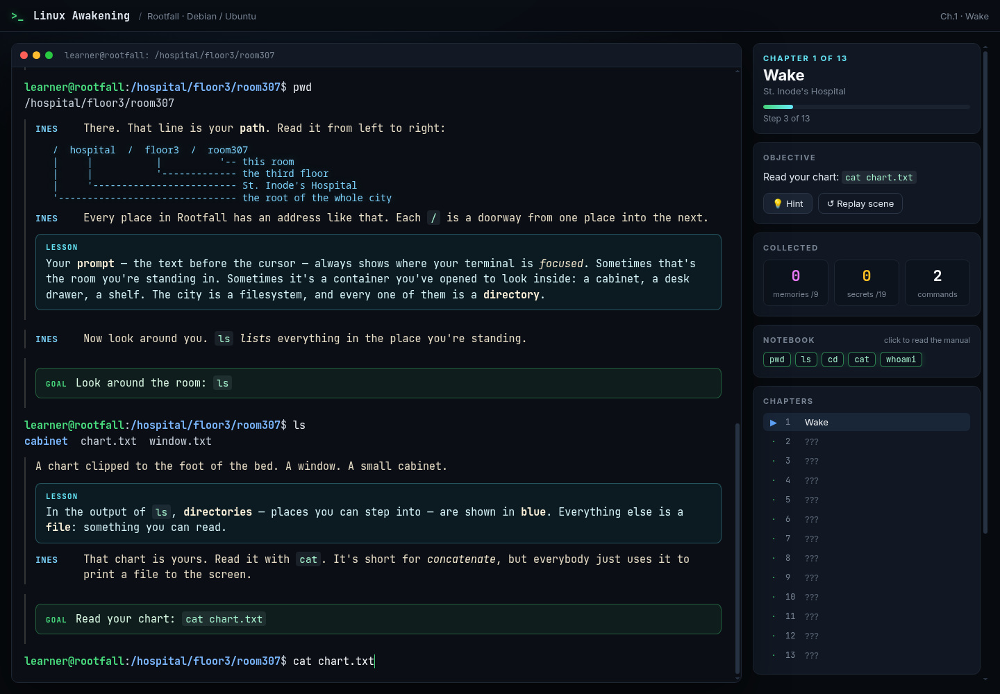
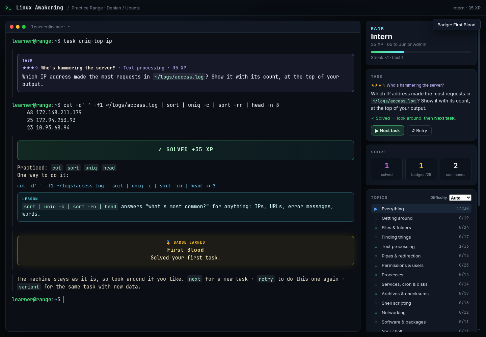

# Linux Awakening

Learn the Linux command line through interactive stories and hands-on practice. Work with files, pipes, permissions, processes, scripts and networking inside a simulated machine in your browser.

| Rootfall | Practice Range |
| --- | --- |
| [](docs/screenshots/rootfall.png) | [](docs/screenshots/practice.png) |

| Mode | Experience |
| --- | --- |
| **Rootfall** | A gentle mystery in a city whose streets are directories. Recover your memories across 13 chapters, with a penguin for company. |
| **Night Train** | A stolen atlas, a missing engineer and a sleeper train approaching the border. A faster, hands-on investigation across 14 chapters. |
| **Practice Range** | Over 200 task types across 14 topics, from single commands to multi-step challenges. Choose a skill, get hints, retry and track your progress. |

Choose **Debian/Ubuntu, Fedora/RHEL, Arch Linux or openSUSE** to practice that family's package tools and defaults. Progress saves automatically in your browser.

## Run locally

No build step or dependencies. Open `index.html` in a modern browser, or serve the project folder:

```bash
python3 -m http.server 8000
```

Visit [localhost:8000](http://localhost:8000) and pick a story or the Practice Range.

## Get started

- Type a command and press **Enter**. Your current goal appears in the terminal and side panel.
- Use `hint` when stuck and `man <command>` for help. Click a notebook command to read its manual.
- **Tab** completes names, **↑/↓** recalls commands and **Ctrl+C** cancels a running command.
- In the Practice Range, use `topic` and `level` to choose exercises, `check` for feedback, and `retry` to try again. Use `next` after solving a task.

See the [playing guide](docs/playing.md) for all controls, practice scoring and distro differences, or the [chapter curriculum](docs/curriculum.md) for the skills each story teaches.

## Development

Built with plain JavaScript, HTML and CSS. The filesystem, shell and commands run client-side.

With Node.js installed, run the test suite:

```bash
npm test
```

See the [development guide](docs/development.md) for the architecture, task and story formats, and individual test commands.
